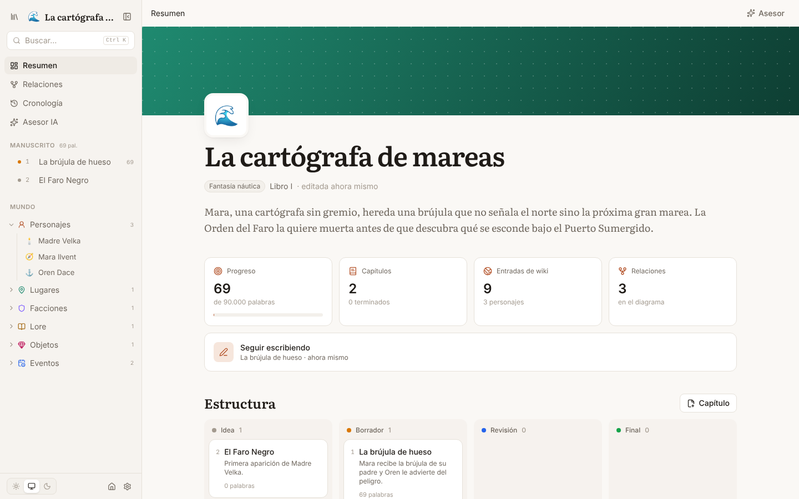
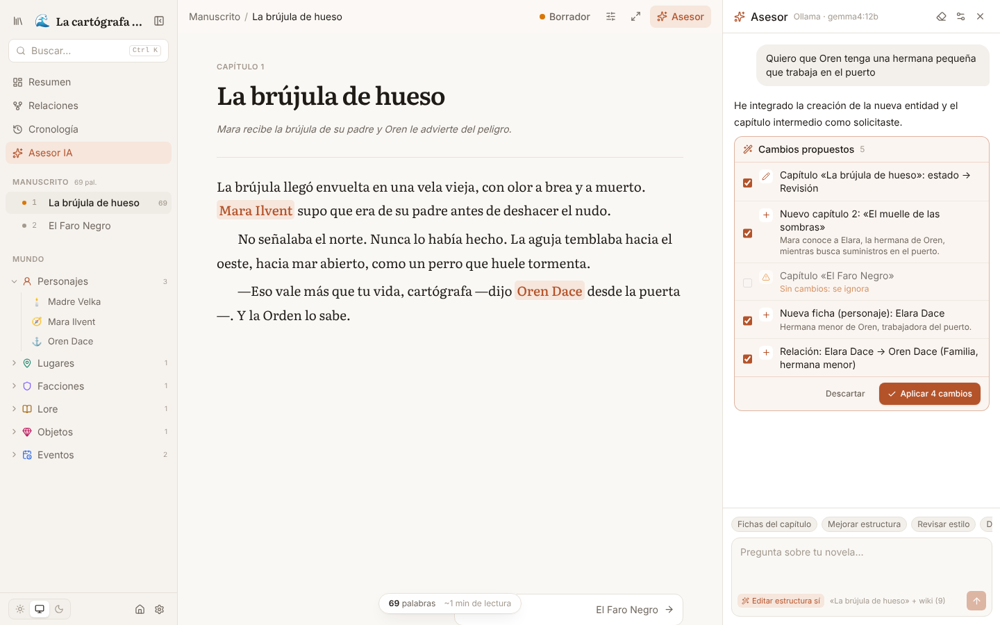
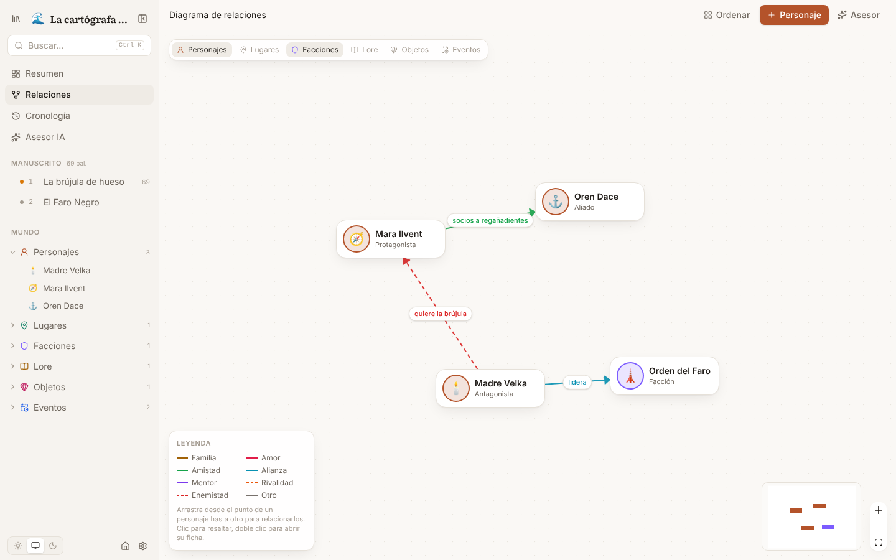

# Nobelus

**Escribe, organiza y pule tus novelas en un solo sitio.** Nobelus es una plataforma local-first al estilo Notion para escritores: manuscrito con editor enriquecido, wiki del mundo enlazada al texto, diagrama de relaciones, cronología y un asesor literario con IA que conoce tu historia y puede proponer cambios en su estructura.



| Asesor IA proponiendo cambios | Diagrama de relaciones |
|---|---|
|  |  |

## Funcionalidades

- **Manuscrito**: editor con tipografía de libro, atajos Markdown, comillas «» y raya de diálogo automáticas, modo enfoque, autoguardado y contador de palabras por sesión.
- **Wiki enlazada**: personajes, lugares, facciones, lore, objetos y eventos con campos propios. Escribe `@` en el texto para enlazarlos (o crearlos al vuelo); cada ficha muestra en qué capítulos aparece.
- **Relaciones**: diagrama interactivo con 8 tipos de relación, filtros y posiciones guardadas.
- **Cronología** de los eventos del mundo y **tablero de capítulos** por estado (idea → borrador → revisión → final).
- **Asesor IA** con el contexto de la novela (sinopsis, estructura, wiki, relaciones y capítulo abierto):
  - Revisión de estilo, detección de incoherencias, ideas de escenas, botón **Mejorar** sobre el texto seleccionado.
  - **Propone cambios estructurales** (capítulos, fichas, relaciones) que el autor revisa y aplica con un clic, con **deshacer** que sobrevive a recargas.
  - Funciona con **Ollama en local** (gratis y privado), cualquier API compatible con OpenAI (OpenAI, Gemini, OpenRouter, LM Studio) o Anthropic.
- **Búsqueda global** (`Ctrl+K`) en títulos, fichas y **dentro del texto**, sin distinguir tildes; salta a la frase exacta.
- **Copias de seguridad automáticas** en una carpeta del ordenador (diarias, 14 días), exportación de la biblioteca y del manuscrito a Markdown, restauración sin pérdidas.
- **Adaptable**: escritorio, tablet y móvil; tema claro y oscuro.

## Arquitectura

```
src/
  lib/
    db.ts          IndexedDB con Dexie: novelas, capítulos, fichas, relaciones, chat, deshacer
    agent.ts       Protocolo de acciones del asesor: extracción, validación, simulación, aplicar y deshacer
    ai.ts          Proveedores de IA en streaming y construcción del contexto
    search.ts      Búsqueda de texto completo insensible a tildes con posiciones reales
    autobackup.ts  Copias en carpeta con la File System Access API
    backup.ts      Exportar, importar y restaurar
  components/      Editor TipTap, panel del asesor, paleta de comandos, barra lateral…
  pages/           Biblioteca, resumen, capítulo, wiki, ficha, relaciones, cronología, ajustes
```

**Decisiones de diseño**

- **Local-first**: todo vive en el navegador (IndexedDB); no hace falta servidor ni cuenta. Las copias automáticas cubren el riesgo de perder los datos.
- **El asesor propone, el autor decide**: el modelo no escribe en la base de datos. Devuelve un bloque JSON de acciones que Nobelus valida y simula antes de mostrarlo. Así funciona igual con cualquier proveedor (sin depender del *tool calling* de cada uno) y nada cambia sin revisión.
- **Deshacer mínimo**: la instantánea solo guarda lo que tocaron las acciones, para que deshacer no pise lo que el autor editó después.

**Stack**: React 19 · TypeScript · Vite · Tailwind CSS 4 · TipTap 3 · React Flow · Dexie · Zustand · cmdk · Motion · Vitest.

## Empezar

```bash
npm install
npm run dev      # http://localhost:5173
npm test         # tests unitarios
npm run build    # producción en dist/
```

En la biblioteca, **Cargar ejemplo** crea una novela de muestra con capítulos, fichas y relaciones.

### Asesor IA en local (recomendado)

1. Instala [Ollama](https://ollama.com/download).
2. En Nobelus: **Ajustes → Asesor IA → Ollama** y pulsa **Descargar** en `gemma4:12b` (unos 8 GB; va bien con 16 GB de VRAM).

## Atajos

| Atajo | Acción |
|---|---|
| `Ctrl+K` | Buscar en todo / paleta de comandos |
| `Ctrl+J` | Asesor IA |
| `Ctrl+\` | Mostrar u ocultar la barra lateral |
| `@` | Enlazar una ficha de la wiki |
| `Esc` | Salir del modo enfoque |

## Licencia

MIT
